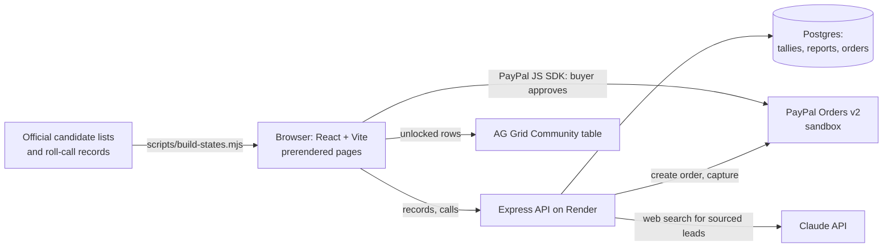

# Legit or Full of Shit

> Public copy of a private development repository, updated Nov 10, 2026 with the code unchanged. Earlier commit history is not included; HACKATHON_CHANGES.md records the dated build log, and AI assistance in the build is disclosed in the Devpost entry.

## For judges (PayPal AI Hackathon)

Politicians say one thing and vote another. This site puts each politician's word-for-word quote
next to their official recorded vote, links both to the source, and lets you make the call. We give
no scores and no verdicts.

**Who it's for:** voters who want to check whether the people who represent them do what they said.
The Nov 3, 2026 election is over, so the site now follows the winners: are they voting the way
they talked and doing what they pledged?

**Live site:** https://legitorfullofshit.com
**Repository:** https://github.com/susanwelland/legit-or-full-of-shit-public (Apache 2.0, see `LICENSE` and `NOTICE`)

### Try it in two minutes

1. Open a record:
   https://legitorfullofshit.com/utah/lake/b-stephanie-pitcher-utah-senate-14/
   It shows a statement from Senator Stephanie Pitcher next to her official Senate vote on HCR 9 (Great Salt Lake, passed 26-1 on March 6, 2026), and each one links to its source.
   (Or type any ZIP on the home page.)
2. Click **Legit** or **Full of shit** to make your call and see the public tallies.
3. Scroll to **The evidence file** and click **Have the Eagle build it**.
4. Pay the $1.00 unlock with a PayPal sandbox buyer (next section). No real money moves.
5. The file opens as a grid you can sort, filter and search. Every row links to its source. Under it is
   a receipt with PayPal's own order and capture ids. Reload, or come back later in the same browser,
   and it opens unlocked again with the same receipt.

**To test again from scratch:** open the page in a private window, or clear this site's data. The
unlock is tied to a random ID stored on your device (`lofs-voter`), so a fresh browser starts locked.
The site has no accounts or logins.

### Get a PayPal sandbox buyer account

The checkout runs in PayPal's sandbox. You need a sandbox *personal* (buyer) account. These hold
fake money and are free.

1. Sign in at https://developer.paypal.com with any PayPal account, or create one for free.
2. Go to **Testing Tools > Sandbox Accounts**. PayPal usually creates a default *Personal* account. If
   there isn't one, click **Create account**, choose **Personal** and **United States**.
3. Open that account's details to see its sandbox email and password.
4. In the PayPal window on our site, sign in with that sandbox email and password and approve the
   payment.

PayPal's sandbox also shows a **Debit or Credit Card** button. It accepts PayPal's sandbox test card
numbers, which you can generate in the developer dashboard. We never publish a shared buyer login.

### How it fits together



- **Records:** candidate lists and roll-call votes come from each state's official files. Only
  votes marked as official records get built in, and `scripts/build-states.mjs` refuses any quote or
  vote that doesn't name someone on the ballot and a real measure. Quotes are word for word, each
  with a link. A gap we couldn't fill is stated on the page, for example Ohio House District 88.
- **Payment:** the server sets the price (`REPORT_PRICE_USD`, $1.00). `POST /api/paypal/orders` creates
  the order and ties it to the visitor's device ID and the report. The buyer approves in PayPal.
  `POST /api/paypal/orders/:id/capture` captures it on the server. The server checks the status,
  the amount, the currency and the order reference before it marks the order captured. If the result
  is unclear, it asks PayPal what happened instead of guessing. Repeat callbacks are safe.
- **Unlock:** `GET /api/reports/:id` returns the rows only when that device has a captured order for
  that report. The browser never decides on its own that a payment went through.
- **AI:** Ask the Eagle and the evidence file use Claude with web search (`ANTHROPIC_API_KEY`). The
  results are labeled as AI and as unchecked leads, each with its source. The Eagle reports only what
  a source says and never judges the candidate. Paying never changes what a file says.
- **Grid:** the unlocked file is an AG Grid Community table with sorting, filtering and search. The
  same grid shows every state's full roll call.

### Built since Oct 1, 2026

All of this was built during the hackathon window. `HACKATHON_CHANGES.md` has it by date, and the
commit history backs it up.

- Records from official sources for 18 states: Utah, Arizona, California, Florida, Georgia, Idaho,
  Maine (House votes), Michigan, Minnesota, Nevada, North Carolina, Ohio, Oregon, Pennsylvania, Texas,
  Washington, Wisconsin and Wyoming. More than 5,400 officials and candidates, and more than 13,000
  official roll-call votes.
- The said-vs-did pages, public tallies, Share your call, and "Who votes like you" quizzes built from
  real votes.
- The evidence file: PayPal Orders v2 sandbox checkout, server-side capture, and an unlock tied to the
  device, shown in AG Grid.
- Ask the Eagle research with Claude web search.
- Home page: a ZIP box that opens your state, then a street address to narrow to your own races.
  Accessibility controls (larger text, high contrast, reduced motion). Prerendered, indexable pages.
- Privacy-first analytics: no names, emails or ZIPs are recorded.

### Every place PayPal is used

All of them use the same path: the server sets the price, creates a PayPal Orders v2 order, the buyer
approves in PayPal, and the server captures and verifies it before anything is delivered. Each one
ends with a receipt showing PayPal's order and capture ids. All run in the PayPal sandbox.

| What | Price | Where to try it |
| --- | --- | --- |
| Evidence file: every source on one person and issue, in an AG Grid table | $1.00 | Any person's page, "Have the Eagle build it" |
| Feed the Eagle: a tip to keep the research going | $3, $5, $10 or $25 | https://legitorfullofshit.com/feed/ |
| "Wear your call" T-shirt: the person's name and your call printed on the back (sandbox orders only ever make an unpaid Printful draft; nothing prints or ships) | $24.00 | Any person's page, after you click Legit or Full of shit: pick a size, "Order this shirt" |
| "I Made the Call" printable certificate | $1.00 | https://legitorfullofshit.com/utah/shop/ (make a call on any Utah record first) |
| Donkey Tracker (pilot): email alerts when one candidate's record changes | $5.00 | Person pages, when switched on (see "Donkey Tracker" below) |

### Sponsor and partner tools used

- **PayPal:** the JavaScript SDK for buyer approval, plus Orders v2 on the server to create and capture
  orders (sandbox). This is how the evidence file is bought and unlocked.
- **AG Grid Community** (MIT): the evidence file table and the roll-call tables.
- **Claude (Anthropic API)** with web search: Ask the Eagle and the evidence file's sourced leads.

### Known limits

- The free API server sleeps when idle. The first request after a quiet spell can take about a minute.
- Checkout stays in the PayPal sandbox for judging. The shop and the evidence file never take real money.
- Maine has House votes only, for now. Ohio House District 88 is not on file yet and is left out of
  comparisons.
- Web-search results are leads, not checked records, and they're labeled that way.

---

# Operations manual

Everything below is for running and updating the site. Hackathon work is tracked in
`HACKATHON_CHANGES.md`. Day-to-day content updates: `docs/UPDATING_POSTS.md`.

## 1. Stack (same as escaperelocate.com)

- Editor: VS Code
- Source control: GitHub
- Framework: Vite + React (no router, no state library)
- Host: Render Static Site (`render.yaml` is included)
- Forms: Formspree for corrections and candidate responses (not wired yet)
- Tallies: Node + Express service with Render Postgres (`server/`)
- Out of scope for Phase 1: Vercel, Netlify, login

## 2. Run it

```
npm install
npm run dev              # local dev server
npm run build            # production build into dist/
npm run preview:single   # also writes preview/legit-or-full-of-shit.html, one self-contained file
```

Deploy: push to GitHub, create a Render Static Site from the repo, point the domain at it.

## 3. Where things live

- `src/data/utah.js` is the whole dataset. Add a state by adding a file like it.
- `src/App.jsx` is the page. `src/styles.css` holds the design tokens and layout.

Data shape: `issues[]` (id, name, blurb, measures) and `people[]`. Each person has
`entries[issueId] = { said[], did[], gap, context }`. Every `said` and `did` item has a `url`
and a `kind`: `official` (government record), `press` (news report), or `tracker`
(third-party vote tracker).

### Issue images

Each issue gets a panel in the scrolling reel at the top. The drawings are original SVGs in
`src/IssueArt.jsx`. To use a photo instead, put the file in `public/issues/` and add this to the
issue in `src/data/utah.js`:

```
image: { src: "/issues/drones.jpg", alt: "...", credit: "Photographer / license", creditUrl: "..." }
```

Only use photos you have the rights to, and keep the credit. A new issue with no drawing and no
photo shows a blank panel, so add one or the other.

## 4. Editorial rules the code assumes

1. Quotes are word for word, with date, setting and link. No paraphrase inside quote marks.
2. Each vote shows the exact motion and tally.
3. A missing quote or record is stated in `gap`. Nothing is filled in from memory.
4. `context` is for facts a reader needs to read the pairing fairly. No opinions.
5. Same method for every candidate and party.

## 5. Public tallies (database)

Calls are counted by a small service in `server/` (Node, Express, Postgres). `render.yaml`
creates the site, the service and the database together.

- `GET /api/tallies` returns counts for every item, plus this device's own calls.
- `POST /api/calls` with `{ key, value }` records `legit` or `fos`. Calls are final: a device's
  first call on an item stands; a different value gets 409 and `null` is refused.
- One call per device per item, and it is final. A device is a random id kept in the
  browser. The service also stores a salted hash of the IP address (never the address) and
  allows 6 devices per network per item, with 30 writes a minute per network.
- This stops casual ballot stuffing. It does not stop a determined campaign with many networks.
  Verified accounts (email or phone) are the next step if that happens.
- The site hides counts until the visitor has made their own call.

Run it locally:

```
cd server && npm install
DATABASE_URL=postgres://localhost/lofs npm start
# in another terminal, from the project root
VITE_API_URL=http://localhost:3000 npm run dev
```

On Render, pick the database plan in the dashboard (the free tier is time-limited), then set
`VITE_API_URL` on the site and `ALLOWED_ORIGIN` on the service as noted in `render.yaml`.
Without `VITE_API_URL` the site still works and keeps calls on the visitor's device.

## 6. Ask the Eagle (research questions)

Under each candidate, a visitor can tell the Eagle what else to research. `src/Eagle.jsx` is the
chat, `src/founders.js` holds the quotes shown while it searches, `src/research.js` sends the
question.

- Every question is saved in the `research_requests` table (candidate, issue, question, time).
- If `ANTHROPIC_API_KEY` is set on the service, it then runs a web search through the Claude API
  and returns a short answer with source links. Without the key, questions are only saved.
- Results are labeled as unchecked leads. They never enter the candidate's file automatically.
  Someone verifies a lead and adds it to `src/data/utah.js` by hand.
- The search prompt limits research to public conduct and refuses home addresses, family and
  private life. The question is treated as untrusted text.
- Limit: 5 questions an hour per network. Each search costs API usage (searches are billed per
  1,000 plus tokens), so set a spending limit on the API key.
- Read the list: `GET /api/admin/research` with header `X-Admin: <ADMIN_TOKEN>`. It returns the
  questions and a count per candidate.

## 7. Public records requests

Some gaps can only be filled by asking the agency. Each request lives in two places:

- the letter, in `records-requests/` (one file per agency)
- a `requests` entry on the person in `src/data/utah.js`, which shows a status card on the page

Workflow: fill in and file the letter, then set `status: "filed"` with `filed` and `due` dates.
When records arrive, put the files in `public/records/`, add each one to the person's `did` list
with `kind: "records"` and a link, and set `status: "received"`. If the agency refuses, set
`denied` and note the appeal.

## 8. Where do you vote?

The roster has a small finder: county, Utah House district, Utah Senate district, U.S. House
district. Once any of them is set, only those races show. It links to the Utah Legislature's
address lookup (https://le.utah.gov/GIS/findDistrict.jsp) for people who do not know their
districts. Races are read from each person's `office` text, so keep the wording consistent:
`Utah House, District 23`, `Utah Senate, District 5`, `U.S. House, District 1`,
`Salt Lake County Sheriff`.

Next step: an address box or clickable map on the site itself. That needs the district boundary
files from the state's GIS office and a geocoder, so it is a separate piece of work.

## 9. Keeping it current

Worth checking every night until the election: new roll calls, changes to the candidate filings,
records request due dates, and new forum transcripts or voter guides. Anything found should land
as a proposed change for a person to approve, because every quote still needs a human read.
This only works once the code is in a GitHub repo, since a nightly job needs somewhere to read
the data from and write its proposals to.

## 10. Utah Top 20, The Odds, Take action

Three more pages, switched from the bar under the title (`#top20`, `#odds`, `#action`).

- **Utah Top 20** reads `src/data/top20.js`. Each item has the sentence its source supports, the
  poll details, a note, sources, and `basis`. `poll` items come from one poll's ranking and are
  shown first, sorted by their percentage. `editor` items follow, unnumbered, in array order,
  because their numbers come from different polls and records. The "where the numbers come from"
  box counts Deseret News sources itself. Change `asOf` with every edit. Once tallies are
  live, the page also shows which issues visitors here are making calls on.
- **The Odds** reads `src/data/markets.js`. Its wording says trading, not betting. Build the
  static site with `VITE_ODDS=off` to hide it. Prices go stale within hours, so update `readAt` and
  the numbers together, from the market pages themselves.
- **Take action** and the "Send email now" button (shown after a visitor makes a call) build an
  email from the person's file. Addresses live in `src/data/contacts.js`, each with the page it
  was read on. A person with no confirmed address gets a link to a contact page instead.
  Nothing is sent by the site: the visitor copies the text or opens their own email app.

- **Blog** reads `src/data/posts.js`. A post is a list of blocks (paragraph, heading, list, quote,
  links, letter). Published letters live in `src/data/letters.js` with the requester's name and
  contact details removed. Never paste a filled-in letter into the project.

- **Wear your call** (`src/ShirtMock.jsx`, `server/shirt.js`, `server/printful.js`). After a
  visitor makes a call, a mock-up shows the back of a shirt: the candidate's name, "I voted", and
  their call. With the static site built with `VITE_SHOP=on` it can be ordered through the same
  PayPal Orders v2 flow (sandbox). The server only sells it for a call that visitor has recorded,
  takes the name from the site's data (never from the browser), and draws the back print itself
  (`GET /api/shirt/back.png`, 3600 px wide, rendered with resvg and the site's fonts). A paid
  shirt is sent to Printful as a black tee (catalog product 71) with the eagle and SHOW ME THE
  RECEIPTS on the front (`GET /api/shirt/front.png`, drawn from `src/data/shirtArt.js`, the same
  drawing the site shows when visitors press Flip) and that print on the back
  and the shipping address PayPal collected; the site does not keep the address. Sandbox
  payments only ever create Printful drafts, which print nothing and cost nothing.
  `GET /api/admin/printful` (admin token) shows which sizes map to Printful variants.

- **Follow a candidate** (`src/Follow.jsx`, `server/follows.js`): email or text, the visitor's
  choice. Keeps only the contact and who they follow, never their calls. Email followers get a
  confirmation through Resend; `POST /api/admin/notify` (admin token) emails a person's followers
  when their file changes. Text numbers are stored with the consent wording shown
  (`src/data/signup.js`); sending texts needs a texting service, not connected yet.
  `GET /api/admin/follows.csv` feeds a spreadsheet, like `/api/admin/signups.csv`.

- **Feed the Eagle** (`src/Feed.jsx`, `/feed`) is a tip jar on the same PayPal flow: $3, $5, $10
  or $25, priced by the server (any other amount is refused), with no shipping step. The Eagle's
  automatic email reply links to it, and says plainly that it is in PayPal's test mode while
  checkout runs in sandbox. `DONATE_URL` overrides the link. Feeding the Eagle never changes what
  the site says about anyone.
  - The separate tip jar is outside the hackathon entry and is currently configured for the PayPal sandbox, like the shop and evidence-file checkout.
  - The free API sleeps when idle, so the Feed page keeps asking for up to about 90 seconds and
    shows "Connecting to PayPal…" instead of "not connected".

- **The evidence file** (`src/EvidenceFile.jsx`, `server/reports.js`) sits at the bottom of every
  candidate file. The Eagle gathers every statement, record and source on that person and issue
  into one table. The row count and one preview row are free. The full table unlocks after a
  captured PayPal sandbox order (`REPORT_PRICE_USD`, default 1.00), and the server only sends the
  rows to the visitor who paid. The table is AG Grid Community (MIT). It never contains a verdict.
  With `ANTHROPIC_API_KEY` set, the Eagle also searches the web and keeps only rows whose link the
  search actually returned. Without `VITE_API_URL` the page shows a labeled free sample instead.

Keeping these current is the same nightly job as section 9: re-read each Top 20 source, check for
a newer poll, refresh market prices, and propose changes for a person to approve.

## 11. Open checks (the site is live; updated Nov 10, 2026)

Still open:

- Run one real PayPal sandbox purchase of the evidence file, start to finish, on the live site.
  (The shop is hidden, so it no longer needs its own test. Donkey Tracker gets its own once it is
  switched on.)
- Listen to the KZMU forum audio and confirm the Grand County quotes. The transcript was
  machine-generated; the page already says the audio is the record.
- Read each quote on its source page once more for punctuation.
- Decide whether one call per device is a strong enough limit on the public tallies.
- Spot-check every address in `src/data/contacts.js` on its source page. Several people have none yet.
- Have a lawyer review the name, the pairing rules and the corrections process.

Done:

- ~~Replace every `tracker` source with the official le.utah.gov roll call.~~ Oct 11, 2026.
- ~~Deploy the tally service and database.~~ Live at api.legitorfullofshit.com on Render.
- ~~Update the records request cards.~~ Both requests were filed Oct 6, 2026. Grand County's records
  arrived Oct 7 and Salt Lake County's Oct 16, and the cards in `src/data/utah.js` say so.
- ~~List challengers to sitting legislators.~~ All 221 candidates on Utah's ballot are listed
  (section 21). Those with no quote yet show an empty file.
- ~~Run the Eagle's web search against the live Claude API.~~ Seen answering on the live site Nov 9, 2026.

## 12. Rules, terms and privacy

`src/Legal.jsx` holds three pages linked from the footer: House rules (`#rules`), Terms of service
(`#terms`) and Privacy (`#privacy`). The terms and privacy pages are drafts and say so on the page.
Have a lawyer read them before launch, and keep the privacy page true to what the code stores.

## 13. Running everything on your own computer

Two windows, nothing to install beyond Node:

1. `npm run api` starts the service on http://localhost:3001 with an embedded database kept in
   `server/.localdb`. It reads PayPal keys from `.env` in the project folder if that file exists
   (`PAYPAL_ENV=sandbox` plus the sandbox client ID and secret). With no `.env` it runs mock checkout.
2. `npm run dev:full` starts the site pointed at that service, so tallies, the Eagle's saved
   questions, the shop and the evidence file all work.

`npm run dev` on its own still runs the site with no service. `.env` is never committed.

## 14. Home page and states

`/` is the home page (`src/Home.jsx`): one real record, then a state picker. Utah lives at `/utah`,
its pages at `/utah/top20`, `/utah/odds` and so on, an issue at `/utah/lake`, and the policy pages
at `/rules`, `/terms`, `/privacy`. Addresses are handled in `src/route.js`. Old links such as
`/#lake` still land on the right page. The single-file preview keeps the same addresses after a `#`.

Other states are open too (California, Oregon, Wyoming); see "Adding a state" at the end.

## 15. Logo

The mark is the eagle's head on a dark tile (`public/favicon.svg`, and `Mark` in `src/Eagle.jsx`).
Logo files with the lettering converted to shapes, so they need no font: `public/logo.svg`
(one line), `public/logo-stacked.svg`, `public/logo-stacked-dark.svg`. PNG copies are in
`docs/brand/`. The lettering is Bricolage Grotesque (SIL Open Font License).

## 16. The Eagle's reply and "email me the findings"

The Eagle's first line repeats the visitor's question and says what actually happened: nothing in
the file yet, searched and found leads, or searched and found no source it could link. It never
says no public information exists. After a saved question the visitor may leave an email
(`POST /api/research/:id/notify`); it is stored on that question as `notify_email` and shows in
the research list at `/api/admin/research`. Nothing sends email automatically. Whoever works the
research list sends the findings by hand, so only promise this while someone is doing that.

## 17. Roll call

`/utah/votes` (`src/RollCall.jsx`) lists every vote and official action on file in one AG Grid
Community table: person, vote, measure, exact motion, issue, office, party, date, result and a
link to the record. It is free and built from `src/data/utah.js`, so it updates with the data.
Clicking a name opens that person's file.

## 18. Shirt mock-up

After a visitor makes a call, `src/ShirtMock.jsx` shows the back of a shirt with that person's
name and "I voted Legit!" or "I voted Full of Shit!", matching the call. It is a picture only:
nothing is for sale. Name only, never a photo, and both versions exist for every person.

## 19. Utah page order

The page keeps the promise in its first line: the issue tabs and the said-vs-did file come
straight after the navigation. The illustrated issue panels and the founder note sit below the
measures. On phones the finder starts folded and the list of people scrolls sideways, so the first
quote and vote are about one screen down instead of four.

## 20. Rotation and "Most divided"

With nobody picked, the Utah page opens a random person who has both a quote and a record on file
for that issue, chosen once per visit. "Most divided" (`src/Divided.jsx`) lists up to five calls
closest to an even split, once at least 10 people have called them. It shows the numbers only for
calls the visitor has already made.

## 21. Everyone on the ballot

`src/data/utahBallot.js` lists all 221 candidates on Utah's November 3, 2026 ballot for U.S. House,
Utah Senate, Utah House and State School Board, generated from the Lieutenant Governor's
`Candidate-Filing-2026.xlsx` (rows marked "Election Candidate", list updated Oct 5, 2026).
People who already have a file are matched by race and family name and not listed twice.
Everyone else appears once a visitor picks where they vote, with an empty file, no call buttons
and the Eagle open for research requests. County races are not in that list and are added by hand.
To refresh: drop a newer spreadsheet in Drive and regenerate the file; do not edit it by hand.

## 22. Local races

`src/data/utahLocal.js` adds county offices, county and school boards and special districts from
county clerks' general election notices (working dataset of Oct 10, 2026). Only rows marked
certified for the general election are used, which covers 21 of Utah's 29 counties; none is
certified complete. Each person links to their own county document. Picking a county now shows
every race in it, including people whose file covers a different issue.

## 23. Records the site hosts

Records released to this site under GRAMA live in `public/records/<agency>/`, named
`YYYY-MM-DD_short-description.pdf` with the release date. They are published exactly as released.
Check every page for the requester's personal details before adding one. Data entries point at them
as `/records/...`; `fileUrl()` in `src/route.js` makes that work in the single-file preview too.

## 24. Corrections

`/corrections` (`src/Corrections.jsx`) sends corrections through Formspree (form `xaeqjare`), which
emails them to the site. Fields: name, the official or candidate, the page, what is wrong, the
source, email, and "I'm the named official or their staff". When that box is checked the email
subject starts with "PRIORITY (official or staff)" so those are read first. Every person's file has a
"Send a correction" link that fills in their name and the page. Linked from every footer.

## 25. Official roll calls

`src/data/utahLegislature.js` holds official le.utah.gov roll calls, read from the vote-page PDFs,
with names exactly as printed and each list checked against its printed count. It also lists the
72 candidates on the ballot who sat in the 2026 session, matched by seat to the House and Senate
rosters and to the name each roll call prints. Every one of them gets a Great Salt Lake file built
from those roll calls (House: HB 328 and HCR 9; Senate: HCR 9). People with a hand-written file keep
it. Every vote on the site now links its official roll call; none relies on a third-party tracker.
Regenerate the file; do not edit it by hand.

## 26. License

The source code is licensed under the [Apache License 2.0](LICENSE). `NOTICE` lists what the
license does not cover: the name "Legit or Full of Shit", the Eagle and the logos (the project's
brand, not licensed for reuse), quotes (they belong to their speakers and publishers), and
government records (public records from the agencies named in each entry). AG Grid Community is
used under the MIT License.

## 27. The Eagle's inbox (eagle@legitorfullofshit.com)

Mail to any address at legitorfullofshit.com is received by [Resend](https://resend.com), which posts
an `email.received` webhook to `POST /api/inbound/resend` (`server/inbox.js`). The signature is
checked, the message is fetched from Resend's receiving API, filed in the `inbox` table, sorted by
the Eagle into one of ten categories, and copied to `INBOX_FORWARD_TO` with a tag in the subject:
`[Eagle · tip]`, or `[Eagle · NEEDS YOU · records]` when a person must act.

- **Always a person:** records-request replies (fee notices and requests to narrow are never answered
  automatically), officials and agencies, lawyers, press, payments and corrections. Rules on the
  sender and text decide this, and they can only add caution to the Eagle's sorting, never remove it.
- **Automatic:** one fixed receipt for tips, corrections and general questions, at most one per sender
  per day, never to automated senders and never when the message contains text aimed at an AI.
- **Never:** the Eagle cannot send free-written replies, change the site, publish anything or follow
  instructions in a message. Spam is still copied to the owner, tagged, so nothing is lost.
- `GET /api/admin/inbox` with the `X-Admin` header lists everything, flagged messages first.

Environment: `RESEND_API_KEY`, `RESEND_WEBHOOK_SECRET`, `INBOX_FORWARD_TO`, `INBOX_ADDRESS`.
DNS: the MX record Resend shows for receiving, plus its sending records (SPF and DKIM) so receipts
and forwards are delivered.

## 28. Buying alerts and usage counts

- **Alerts** (`server/alerts.js`): the owner gets a short email at `INBOX_FORWARD_TO` when a visitor
  builds an evidence file, starts PayPal checkout, or completes a payment. At most one email per kind
  every ten minutes; the next one says how many were held. No buyer details are included.
- **PostHog** (`src/analytics.js`): runs only on legitorfullofshit.com, never in previews or local
  development. The public project key is in the file (`VITE_POSTHOG_KEY` overrides it). Memory
  persistence (no cookies or storage), no autocapture, no session recording, all text masked. Events:
  `$pageview`, `call_made`, `share_call`, `evidence_file_built`, `donate_click` (the "Toss it a snack" button; `where` is home or footer), `shop_view`, `product_click`, `checkout_start` and `checkout_complete` (sandbox for the shop and evidence file), plus `ask_stance`, `ballot_lookup`, `follow`, `match_done` and `state_signup`. In the
  PostHog project, turn on "Discard client IP data" to match the privacy page.

## 29. Find my ballot

Visitors pick their state first (home page map or Open Utah). The state page then takes a home
address and sends it to `POST /api/lookup` (`server/lookup.js`), which asks
the U.S. Census Bureau's free geocoder (no key) for the county, U.S. House, state Senate and state
House districts. The address travels in the request body, is never stored or logged, and only the
districts are kept, in the browser (`lofs-place`), and the page narrows to the visitor's races.
An address in another state gets a note instead. Utah's U.S. House map changed for 2026 and the national lookup may still have the
old lines, so for Utah the U.S. House district is left for the visitor to pick (`NEW_US_MAP` in
`src/FindBallot.jsx`). States without a page get a "not open yet" note.

## Agree to Disagree (comment board)

`src/Board.jsx`, `src/BoardArt.jsx`, `src/BoardAdmin.jsx`, `server/board.js`. Hidden unless the static
site is built with `VITE_BOARD=on` (like `VITE_SHOP`). Lives at `/utah/board`, a thread at
`/utah/board/<slug>`. Every thread is opened by Angelica, the site's AI host (labeled "AI host · not a
person" wherever she appears; she never states an opinion). Her photo is `public/img/angelica.jpg`; if it
fails to load, a drawn golden doodle is shown instead.

- **Threads** come from the dataset. Three Utah threads (HB 328, HB 76, HB 468) are seeded on every
  start and refreshed from `src/data/utah.js`: the opener uses the measure's own wording, the receipt
  lists every official roll call on file for the measure, and "On the record" pulls two members who voted
  opposite ways, with a quote exactly as stored (none for HB 468: both "no" votes belong to people with no
  file yet). No sample comments are ever seeded.
- **Sign-in** is an emailed link, no password: `POST /api/board/join` sends a one-time link (20 minutes)
  through Resend (`RESEND_API_KEY`, from `INBOX_ADDRESS`; `SITE_URL` sets the link's domain). The site
  trades it at `GET /api/board/login?token=` for a 60-day session, kept in the browser and sent as an
  `X-Board` header (like `X-Voter`). Only hashes of links and sessions are stored. With email off the link
  is logged to the server console, and returned in the response only when `PAYPAL_ENV=mock` or
  `NODE_ENV` is set to something other than `production`, for local testing.
- **Reads:** `GET /api/board/threads?room=utah|everyone`, `GET /api/board/threads/:slug` (thread vote
  counts only for someone who has voted), `GET /api/board/me`. **Writes** (signed in): thread vote,
  comment, comment vote (tap again to clear), report.
- **Anti-spam, all on the server:** an empty honeypot field and at least 3 seconds on the form; the
  site-wide 30 writes a minute per network; 10 sign-in links an hour per network and 4 per address;
  common throwaway email domains refused; comments are held for a check until an account has 2
  approved; links refused until it has 3; 5 comments a day until then (40 after); a comment matching
  the author's own from the last 24 hours, or anyone's from the last hour, is quietly stored hidden;
  shadowbanned users see their own comments as normal and nobody else sees them; 3 reports from members
  with 3 or more approved comments send a comment back for a check. Links in comments get
  `rel="nofollow ugc noopener"`. Usernames such as `angelica`, `admin` and `moderator` are reserved.
- **Admin** (`X-Admin: <ADMIN_TOKEN>`, 404 otherwise): `GET /api/admin/board/queue` (held and reported
  comments), `POST /api/admin/board/comments/:id/approve|hide|delete`,
  `POST /api/admin/board/users/:idOrUsername/shadowban|ban|unban|delete` (`delete` removes the account,
  its comments, votes and sign-in records, for deletion requests), and `POST /api/admin/board/threads`
  with `{ room, slug, title, issue_id, measure_id, opener, question, record? }`. A small queue page sits at
  `/utah/board/admin` (not linked); it asks for the token and keeps it in that tab only.
- **PostHog events:** `board_view`, `thread_view`, `thread_vote`, `comment_post`, `comment_vote`,
  `comment_report`, `board_join_start`. Thread slugs and vote values only, never usernames, emails or text.

## Who votes like you

`src/Match.jsx` with questions in `src/data/match.js`. Each question is tied to one recorded vote
where a yes vote has one plain meaning (HB 328, HCR 9, HB 76, the county data center pauses,
HB 468). A visitor's answers stay in the browser tab. Results count matching Yea/Nay votes only;
absences are shown but not counted. It never recommends anyone.

## Checked quotes

`src/data/utahSaid.js` holds quotes added in bulk. Each was taken from a fetched page and then
re-checked word for word against the same page by a second reader. `note` is context a reader
needs. `utah.js` merges them in, and gives a file to anyone on the ballot who has a quote.

## Donkey Tracker (demo only)

"Donkey Tracker. Follow the Ass." A visitor pays $5 in the PayPal sandbox to follow one candidate and
gets an email when that candidate's record changes. It is a demo-only entitlement: nothing is offered
publicly, no tracking period is promised, and alerts are sent by hand. Code: `server/tracker.js`,
`src/Tracker.jsx`.

- **Switch on:** set `TRACKER=on` on the API service (Render). Email needs `RESEND_API_KEY` and a
  verified sending domain. `TRACKER_SECRET` signs the links (Render generates it; `IP_SALT` is the
  fallback). The panel shows on person pages only in a browser opened once with `?tracker=1`
  (`?tracker=0` hides it again), or in a build with `VITE_TRACKER=on`.
- **Flow:** email + consent box ("Email me when this candidate's record changes.") make a pending
  row. No consent, no row. The server prices the order at $5. The row turns active only after
  the PayPal capture is verified, and the confirmation email goes out once. It has a confirm
  link and an unsubscribe link.
- **Alerts** go only to active, confirmed addresses, once per change per subscription. A failed send
  is not recorded, so it can be retried. Every alert says it is a demo alert sent by hand.
- **Demo trigger:** the "Demo trigger (owner only)" link in the panel, or
  `POST /api/admin/tracker/alert` with the `X-Admin` header and `{ person, summary, source }`.
  Quote the record and link the source. `GET /api/admin/tracker` gives counts (no addresses).
- **Unsubscribe** (the link, or the mail app's own unsubscribe button) deactivates the row and deletes
  the email address. The confirm and unsubscribe pages act only when their button is pressed, so
  mail scanners opening links change nothing. Unpaid starts are deleted after a day.

## Adding a state

Utah's data is bundled with the site. Every other open state is one generated module,
`src/data/states/<slug>.js`, loaded only when someone opens that state. `src/data/states/index.js`
lists them; the map (`OPEN` in `src/Home.jsx`), the address lookup (`OPEN_STATES` in
`src/FindBallot.jsx`), the addresses (`src/route.js`), the tally service and the SEO pages all read
that list, so there is nothing else to register.

1. Put the checked staging files in `<STATE_WORK>/<slug>/` (default `/home/claude/state-work`):
   `ballot.json` + `ballot-source.json` (or a `src/data/<slug>Ballot.js` with `ballot` and
   `BALLOT_SOURCE`, as California has), `issues.json`, `votes.json` and `quotes.verified.json`.
   Only rows with `kind: "official"` in `votes.json` and only `quotes.verified.json` are used.
2. Add the state to `STATES` in `scripts/build-states.mjs`: postal code, name, `places` (one regex
   per districted office, and which lookup field fills it; `from: null` plus a `note` when the
   national lookup cannot be trusted, which keeps that race fully listed) and, if its own votes
   allow it, `questions` for "Who votes like you" (each tied to one measure where a yes vote has one
   plain meaning; the ask restates the measure's own text). A question is dropped automatically
   unless that measure has recorded votes on both sides; with no questions the page hides the view.
3. Run `node scripts/build-states.mjs` (or `node scripts/build-states.mjs <slug>`). It checks that
   every quote and vote names someone on the ballot and a real issue and measure, prints counts,
   writes the module and rewrites the index. Commit the generated files; the build never reads the
   staging folder. Do not edit generated files by hand: fix the staging data and rerun.
4. Optional: add a headline card for the state in `src/data/stateHeadlines.js`. Open states show
   "Open <state>" there instead of "Tell me when <state> opens".
5. `npm run build`, then restart the tally service (`npm start` in `server/` copies the modules
   with `sync-data.mjs`). Call keys stay `issue:person`; person ids carry the state prefix
   (`or-`, `wy-`, `ca-`), and the service refuses to start if two states ever produce the same key.

What a state page shows: Said vs. did, Roll call and (with questions) Who votes like you, plus the
footer pages. Utah Top 20, The Odds, Take action, Blog, Agree to Disagree and the shop stay Utah-only.
Everyone on the ballot has an entry for every issue; an empty one says why in `gap` ("No quote on
file yet.", "No recorded vote on this issue.", or "Not in the Legislature for these votes." for
people with no recorded vote at all). Calls open only where a quote or a vote is on file. Measures
with court `status`, `statusSources` and `statusAsOf` (Wyoming HB 156 and HB 199) show it under the
measure. Vote notes written while a vote still came from a tracker are left out, because every
vote shown is the official record at its `url`.

To hold a state back, delete its module and rerun the converter.


